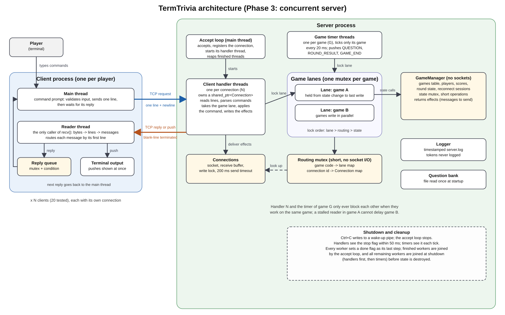
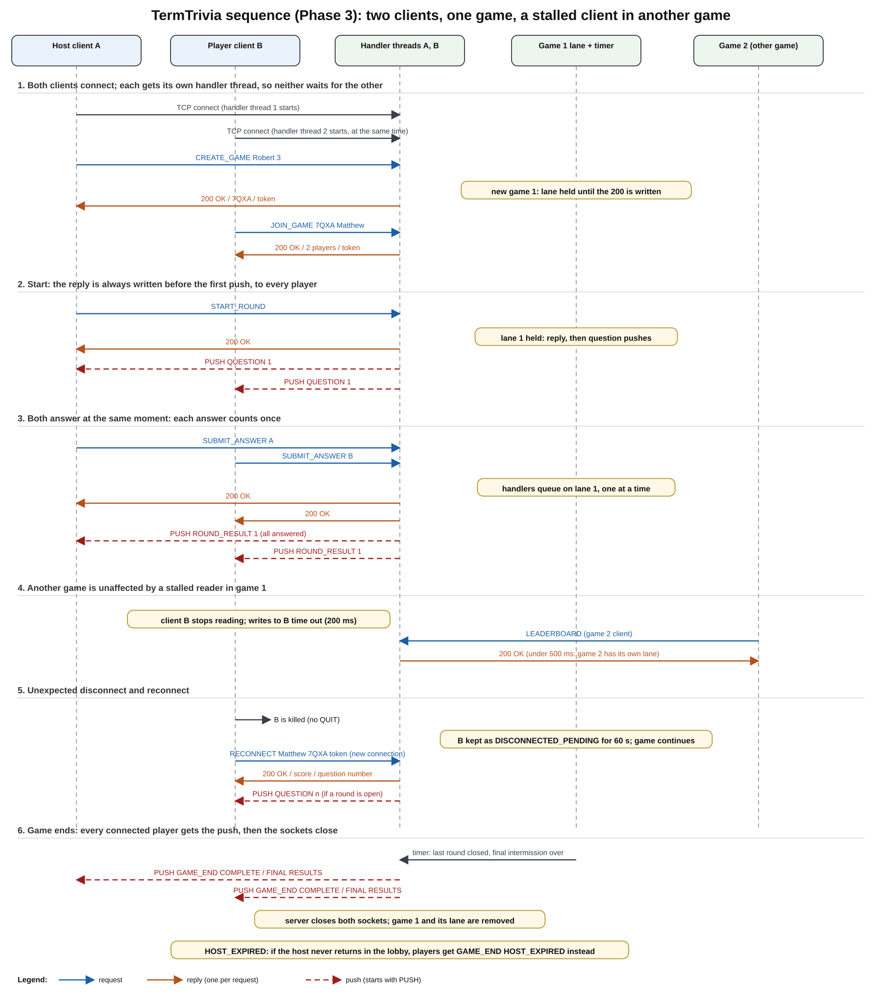

> Copied from the Google Doc tab "5.5 Architecture v2".

# 5.5 Client-Server Architecture (Revision 2)
## TermTrivia

This revision updates the architecture to match protocol revision 2. The main changes are that the client reader thread now sorts server messages into replies and pushes, every connection has its own receive buffer and write lock, and the Phase 3 server serves many clients and many games at the same time (one handler thread per client, one timer thread per game, one lock per game).
### Client application components
Each player runs one client process, host included. The client has two threads and a small reply queue.
- **Main thread (command prompt):** reads one line of user input, checks its format, sends it to the server as one line ending in a newline, and then waits for the matching reply from the reply queue before showing the next prompt.
- **Background reader thread:** the only code that calls recv() on the socket. It adds each chunk to the connection's receive buffer, cuts the buffer into lines at each newline, and collects lines into a message until it reaches an empty line. If the first line of the message starts with PUSH (QUESTION, ROUND_RESULT, or GAME_END), it prints the message at once and shows the prompt again. Otherwise the message is a reply and the thread puts it on the reply queue.
- **Reply queue:** a small thread-safe queue (mutex and condition variable) that carries replies from the reader thread to the main thread. Every command gets exactly one reply, in order, so the main thread simply takes the next one.
- **Connection closed:** when recv() returns 0 bytes, the reader thread tells the user the server closed the connection and the client exits cleanly.
### Server application components
- **Main thread (accept loop):** loads the question bank once, listens on the configured port, and accepts connections. For every connection it starts a new Client Handler Thread and goes straight back to listening. After each wake-up it joins the handler and timer threads that have finished.
- **Connection layer (one per connection):** owns the socket, the receive buffer, and a write lock. It turns incoming bytes into complete lines and sends each outgoing message whole while holding the write lock, so two messages are never mixed together.
- **Protocol layer:** turns one line into a command, validates it, and chooses the error code. It does no socket work and holds no game state.
- **Game logic:** creates games, adds players, scores answers, closes rounds, builds the leaderboard, and ends games. It hands the messages it wants sent to the connection layer and never calls socket functions itself.
- **Client Handler Thread:** reads lines from its one client, runs them through the protocol layer and game logic, and writes the reply. For START_ROUND it writes the reply first and then the first question.
- **Game Timer Threads (one per game):** each drives its own game's 20-second question window, 5-second intermission, and 10-second final intermission, and pushes QUESTION, ROUND_RESULT, and GAME_END. Each also expires that game's reconnect windows after 60 seconds, and ends a lobby whose host did not return (HOST_EXPIRED).
- **Shared Game State:** an Active Games Table (keyed by join code, with players, scores, current question number, and round state) and a Disconnected Sessions Table (saved score and state during the 60-second reconnect window).
- **Logging component:** writes timestamped lines to server.log for startup, listening address and port, connections, each request and its outcome, protocol errors, disconnections, and shutdown. Tokens are never logged.
- **Question Bank:** a file read once at startup and kept in memory.
### Messages on the wire
1. **Requests (client to server):** the eight commands CREATE_GAME, JOIN_GAME, START_ROUND, SUBMIT_ANSWER, LEADERBOARD, RECONNECT, QUIT, and END_GAME. Each is one line.
1. **Replies (server to the requesting client only):** exactly one per command, in order. The first line is a 3-digit code such as 200 OK. A reply is one or more lines followed by a blank line.
1. **Pushes (server to clients, unprompted):** the first line starts with PUSH. QUESTION and ROUND_RESULT are triggered by the Game Timer Thread, GAME_END by the timer or by END_GAME and host QUIT, and a repeated QUESTION by a successful RECONNECT. After START_ROUND the host has no special runtime role until it chooses to end the game.
### How START_ROUND flows
1. The host's main thread sends the line START_ROUND and waits for a reply.
1. The Client Handler Thread checks that the sender is the host and the game is in LOBBY, moves the game to QUESTION_ACTIVE, and writes 200 OK followed by a blank line.
1. Only after that reply is written, the first PUSH QUESTION is written to every active player.
1. On the host's client the reader thread receives the reply and gives it to the main thread. It receives the push, prints it, and shows the prompt again.
1. The Game Timer Thread starts the 20-second round timer and takes over all later pushes.
### Phase 3 server runtime: per-game lanes
This is how the Phase 3 server keeps replies and pushes in the right order while many clients and games run at once (design-changes.md, decisions 38 to 44). It replaces the single coordinator mutex of Phase 2.
- **Threads:** the accept loop; one handler thread per connection (it owns a `shared_ptr<Connection>` and is the only reader of the socket); one timer thread per game that ticks only that game every 20 ms.
- **Game lane:** every game has a lane, a mutex held from the moment a command, timer tick, or disconnect changes that game's state until all of that event's messages have been written. That guarantees a START_ROUND reply is written before its first question and that a QUESTION never follows the ROUND_RESULT of the same round. Different games have different lanes, so they write at the same time. A connection that is not in a game uses a lane of its own.
- **Lock order:** lane, then the short routing mutex, then the game-state mutex inside `GameManager`. The routing mutex guards the game-code-to-lane map and the connection map and is never held across socket I/O; neither is the game-state mutex.
- **Finding the lane:** a command uses the lane of the game its connection is in (JOIN_GAME and RECONNECT use the code in the command). After locking, the lookup is repeated, and retried if the game was removed or replaced, so a stale lookup never touches a later game that reuses a code.
- **Creating a game:** CREATE_GAME holds the new lane before the game is published, starts the game's timer thread, and only then writes 200 OK. If the timer thread cannot start the game is rolled back, the connection is closed, and no reply is sent (the one exception to one reply per command).
- **Direct bounded writes:** effects returned by game logic are paired with their connection while protected, then written under that connection's write lock. A write that blocks longer than 200 ms (`SO_SNDTIMEO`) marks the connection broken, and the handler treats it as an unexpected disconnect. A stalled client therefore delays only writes in its own game, for at most 200 ms each time.
- **Closing connections:** the final message of a session (GAME_END, or the 200 for QUIT) is written, the write side is shut down, and the connection is marked closing, all under the write lock; anything queued afterwards is dropped. The handler then drains input already received, waits briefly for the client to close, removes the connection from the live-connection map, and lets go of it. Pending writes keep the connection object alive, so no write ever reaches a closed or reused descriptor.
- **Worker cleanup:** each handler and timer thread sets a done flag as its last step. The accept loop joins finished threads, so thread count stays bounded. A handler thread that cannot start closes that connection and the server keeps accepting.
- **Shutdown (Ctrl+C):** the signal handler writes one byte to a wake-up pipe. The accept loop waits on that pipe as well as the listening socket, stops accepting, handlers check the stop flag every 50 ms and timers each tick, then handlers and finally timers are joined and `server shutting down` is logged. No protocol push is sent.

### Phase 3 scope
Phase 3 serves several clients and several games at once. A host creates a game, other players join in the lobby or later, and every command, answer, join, quit, reconnect, and server shutdown works while other clients are connected. The tests are listed in `docs/test-plan.md` and the results in `docs/phase3-test-report.md`.
### Persistent storage
The only file the server reads is the question bank, loaded once at startup. There is no other persistent storage. Game state, scores, and connections exist only in memory for the life of a game. The server log is written continuously and is never read back by the application.
