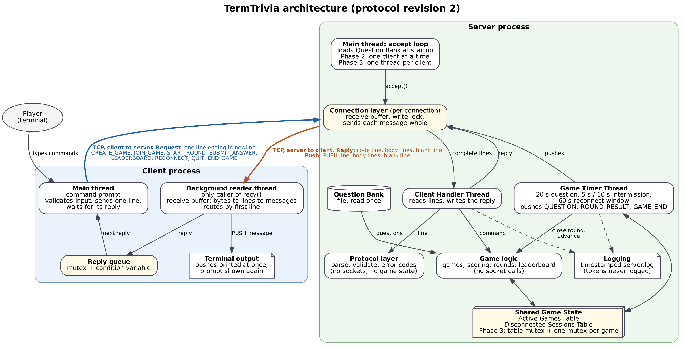
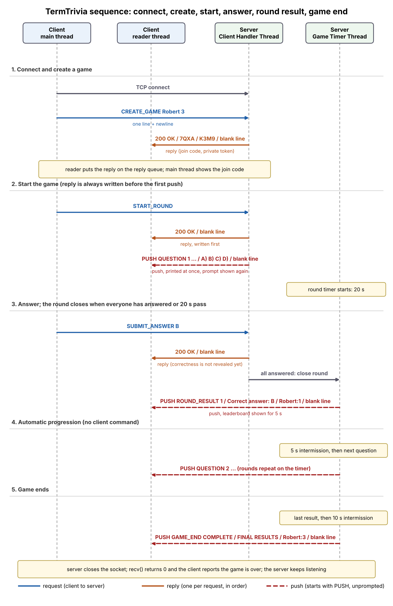

> Copied from the Google Doc tab "5.5 Architecture v2".

# 5.5 Client-Server Architecture (Revision 2)
## TermTrivia

This revision updates the architecture to match protocol revision 2. The main changes are that the client reader thread now sorts server messages into replies and pushes, every connection has its own receive buffer and write lock, and the Phase 2 server accepts one active client at a time.
### Client application components
Each player runs one client process, host included. The client has two threads and a small reply queue.
- **Main thread (command prompt):** reads one line of user input, checks its format, sends it to the server as one line ending in a newline, and then waits for the matching reply from the reply queue before showing the next prompt.
- **Background reader thread:** the only code that calls recv() on the socket. It adds each chunk to the connection's receive buffer, cuts the buffer into lines at each newline, and collects lines into a message until it reaches an empty line. If the first line of the message starts with PUSH (QUESTION, ROUND_RESULT, or GAME_END), it prints the message at once and shows the prompt again. Otherwise the message is a reply and the thread puts it on the reply queue.
- **Reply queue:** a small thread-safe queue (mutex and condition variable) that carries replies from the reader thread to the main thread. Every command gets exactly one reply, in order, so the main thread simply takes the next one.
- **Connection closed:** when recv() returns 0 bytes, the reader thread tells the user the server closed the connection and the client exits cleanly.
### Server application components
- **Main thread (accept loop):** loads the question bank once, listens on the configured port, and accepts connections. In Phase 2 it serves one client at a time. In Phase 3 it starts a new Client Handler Thread for every connection and goes straight back to listening.
- **Connection layer (one per connection):** owns the socket, the receive buffer, and a write lock. It turns incoming bytes into complete lines and sends each outgoing message whole while holding the write lock, so two messages are never mixed together.
- **Protocol layer:** turns one line into a command, validates it, and chooses the error code. It does no socket work and holds no game state.
- **Game logic:** creates games, adds players, scores answers, closes rounds, builds the leaderboard, and ends games. It hands the messages it wants sent to the connection layer and never calls socket functions itself.
- **Client Handler Thread:** reads lines from its one client, runs them through the protocol layer and game logic, and writes the reply. For START_ROUND it writes the reply first and then the first question.
- **Game Timer Thread:** drives the 20-second question window, the 5-second intermission, and the 10-second final intermission, and pushes QUESTION, ROUND_RESULT, and GAME_END. It exists in Phase 2 already, because rounds are timer-driven even with one client. It also expires reconnect windows after 60 seconds.
- **Shared Game State:** an Active Games Table (keyed by join code, with players, scores, current question number, and round state) and a Disconnected Sessions Table (saved score and state during the 60-second reconnect window).
- **Logging component:** writes timestamped lines to server.log for startup, listening address and port, connections, each request and its outcome, protocol errors, disconnections, and shutdown. Tokens are never logged.
- **Question Bank:** a file read once at startup and kept in memory.
### Messages on the wire
1. **Requests (client to server):** the eight commands CREATE_GAME, JOIN_GAME, START_ROUND, SUBMIT_ANSWER, LEADERBOARD, RECONNECT, QUIT, and END_GAME. Each is one line.
1. **Replies (server to the requesting client only):** exactly one per command, in order. The first line is a 3-digit code such as 200 OK. A reply is one or more lines followed by a blank line.
1. **Pushes (server to clients, unprompted):** the first line starts with PUSH. QUESTION and ROUND_RESULT are triggered by the Game Timer Thread, GAME_END by the timer or by END_GAME and host QUIT, and a repeated QUESTION by a successful RECONNECT. After START_ROUND the host has no special runtime role until it chooses to end the game.
### How START_ROUND flows
1. The host's main thread sends the line START_ROUND and waits for a reply.
1. The Client Handler Thread checks that the sender is the host and the game is in LOBBY, moves the game to QUESTION_ACTIVE, and writes 200 OK followed by a blank line.
1. Only after that reply is written, the first PUSH QUESTION is written to every active player.
1. On the host's client the reader thread receives the reply and gives it to the main thread. It receives the push, prints it, and shows the prompt again.
1. The Game Timer Thread starts the 20-second round timer and takes over all later pushes.
### Phase 2 server runtime: coordinator and direct writes
This is how the Phase 2 server keeps replies and pushes in the right order without a separate writer thread (design-changes.md, decisions 31 to 33).
- **Two threads act on the game:** the accept-loop thread, which also runs the connection handler for the one active client, and the Game Timer Thread, which calls `tick(now)` about every 20 ms.
- **Coordinator mutex:** every command, every timer tick, and every disconnect holds one coordinator mutex from the moment the game state changes until that event's messages have been written. That is what guarantees a START_ROUND reply is written before its first question, and that a QUESTION never follows the ROUND_RESULT of the same round.
- **Lock order:** coordinator first, then the game-state mutex inside `GameManager`. The game-state mutex is released before any socket write; no game-state lock is ever held across socket I/O.
- **Direct bounded writes:** the effects returned by game logic are written straight to each connection under that connection's write lock. A write that blocks longer than 200 ms (`SO_SNDTIMEO`) marks the connection broken, and the handler then treats it as an unexpected disconnect.
- **Closing connections:** only the handler/accept-loop thread ever calls `close()`. When the server ends a session on purpose (QUIT, END_GAME, game over) the sending thread writes the final message and calls `shutdown(SHUT_WR)`; the handler then drains any input already received, waits briefly for the client to close, and closes. Before every close the handler removes the connection from the live-connection map while holding the coordinator, so a later effect can never reach a reused descriptor.
- **Shutdown (Ctrl+C):** the signal handler writes one byte to a wake-up pipe. The accept loop waits on that pipe as well as the listening socket, the handler checks the stop flag every 50 ms, then the timer thread is joined and `server shutting down` is logged. No protocol push is sent.
- **Phase 3:** the handler is already a function taking one connection, so Phase 3 can run it on one thread per client; the coordinator can then be narrowed to per-game locking as described below.

### Phase 2 scope
Phase 2 is one client and one server. The server accepts one active client connection, but it already has the timer thread, the receive buffer, and the write lock, because the game cannot run without timed pushes. A single host can create a game, start it, answer, view the leaderboard, end it, quit, and reconnect. Joining as a second player, duplicate-name checks, and several games at once are tested in Phase 3.
### Thread structure planned for Phase 3
Phase 3 uses one thread per connected client, plus the Game Timer Thread shared across all games. The accept loop never waits on a client. The Active Games Table has one mutex that protects adding and removing games, and each game has its own mutex that protects its players, scores, and round state. A thread takes the table mutex before a game mutex and never holds two game mutexes at once, which avoids deadlock. Locked sections are kept short, and no thread holds a game mutex while it waits on a socket. A per-connection write lock protects sends.
### Persistent storage
The only file the server reads is the question bank, loaded once at startup. There is no other persistent storage. Game state, scores, and connections exist only in memory for the life of a game. The server log is written continuously and is never read back by the application.
